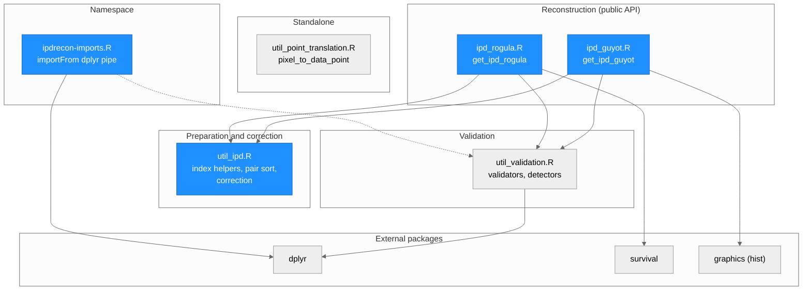
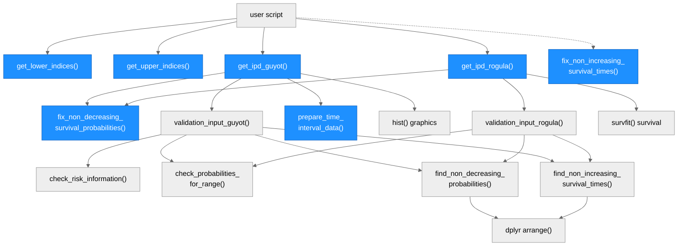
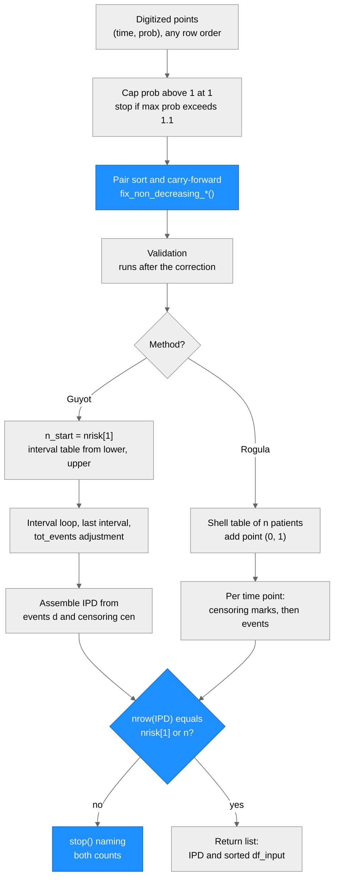
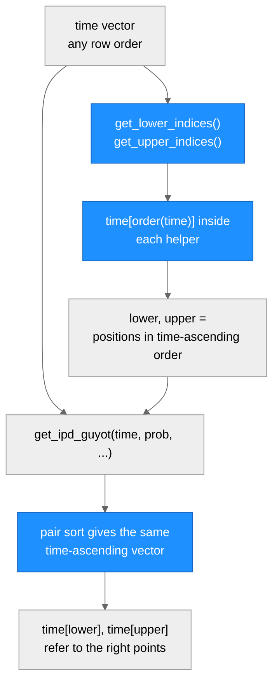

# Architecture — ipdrecon

> Generated by scriber for run `2026-10-28-input-ordering-fix` on 2026-10-29. Describes the package at branch `fix/input-ordering`, built on `c72c02e`. The file is excluded from the package build by `.Rbuildignore`.

## Overview

`ipdrecon` is an R package (R 4.4.3 tested, MIT license) that reconstructs individual patient data (IPD) from digitized points of a published Kaplan-Meier (KM) curve. It wraps two methods: Guyot et al. (2012, `get_ipd_guyot()`) and Rogula et al. (2022, `get_ipd_rogula()`). Both take pairs (time, survival probability). Guyot also needs the at-risk table (`trisk`, `nrisk`) and interval positions (`lower`, `upper`). Rogula needs the number at risk at time zero (`n`) and optional censoring times. The package imports `dplyr` (pipe and `arrange` in the detectors) and `survival` (`survfit` inside Rogula). `graphics::hist` is called without a prefix in Guyot. The code is procedural. There are no classes. Printing in the validators uses `cat()`.

Both reconstruction functions treat a digitized point as a pair. They sort the pairs by time ascending (ties by probability descending), correct rising probabilities by carry-forward, and check that the reconstructed number of patients equals the number at risk at time zero.

---

## Module Structure

> Blue fill = modified in this run. The dotted edge shows that `ipdrecon-imports.R` supplies the pipe operator to the namespace. Only `util_validation.R` still uses it. The user calls `get_lower_indices()` and `get_upper_indices()` (in `util_ipd.R`) before calling `get_ipd_guyot()`.

### Module Reference

| Module / File | Layer | Purpose | Key Exports | Changed |
| --- | --- | --- | --- | --- |
| `R/ipd_guyot.R` | Reconstruction | Guyot et al. algorithm: interval loop, last interval, optional `tot_events` adjustment, IPD assembly, patient-count check | `get_ipd_guyot` | yes |
| `R/ipd_rogula.R` | Reconstruction | Rogula et al. algorithm: shell table of `n` patients, per-point censoring marks and events, patient-count check | `get_ipd_rogula` | yes |
| `R/util_ipd.R` | Preparation | Index helpers, interval table, pair sort with correction | `get_lower_indices`, `get_upper_indices`, `prepare_time_interval_data`, `fix_non_decreasing_survival_probabilities`, `fix_non_increasing_survival_times` | yes |
| `R/util_validation.R` | Validation | Input checks and detectors for rising probabilities and falling times | `validation_input_guyot`, `validation_input_rogula`, `check_valid_numbers`, `check_probabilities_for_range`, `check_risk_information`, `find_non_decreasing_probabilities`, `find_non_increasing_survival_times` | no |
| `R/util_point_translation.R` | Standalone | Linear interpolation from pixel to data coordinates for digitizing | `pixel_to_data_point` | no |
| `R/ipdrecon-imports.R` | Namespace | One roxygen block, `@importFrom dplyr %>%`, and `NULL` | none | yes (new) |
| `NAMESPACE` | Namespace | Generated by roxygen2 7.3.2: 15 exports, one import | n/a | yes (one line added) |
| `man/*.Rd` | Documentation | Generated help pages (seven regenerated in this run) | n/a | yes |
| `DESCRIPTION` | Metadata | Imports `dplyr`, `survival`. Suggests `knitr`, `rmarkdown`, `testthat` | n/a | no |

---

## Function Call Graph

> Blue nodes = changed in this run. The dotted edge marks an exported function that no other function in the package calls. The call to `fd` is the single place where both methods sort (time, prob) pairs and carry rising probabilities forward.

### Function Reference

| Function | Defined In | Called By | Calls | Changed | Purpose |
| --- | --- | --- | --- | --- | --- |
| `get_ipd_guyot()` | `R/ipd_guyot.R` | user | `fix_non_decreasing_survival_probabilities`, `validation_input_guyot`, `prepare_time_interval_data`, `hist` | yes | Guyot reconstruction. Stops when `nrow(IPD)` differs from `nrisk[1]` |
| `get_ipd_rogula()` | `R/ipd_rogula.R` | user | `fix_non_decreasing_survival_probabilities`, `validation_input_rogula`, `survfit` | yes | Rogula reconstruction. Stops when `nrow(IPD)` differs from `n` |
| `get_lower_indices()` | `R/util_ipd.R` | user | none | yes | First position with `time >= trisk[i]`. Sorts `time` internally, so positions refer to the time-ascending order |
| `get_upper_indices()` | `R/util_ipd.R` | user | none | yes | Last position with `time < trisk[i+1]`. Sorts `time` internally |
| `prepare_time_interval_data()` | `R/util_ipd.R` | `get_ipd_guyot`, user | none | yes | Builds the 7-column interval table. Sorts `time` internally so `time[lower]` matches the helpers |
| `fix_non_decreasing_survival_probabilities()` | `R/util_ipd.R` | `get_ipd_guyot`, `get_ipd_rogula`, user | none | yes | Pair sort (time ascending, ties probability descending), then one-pass carry-forward of rising probabilities. Returns `data.frame(time, prob)` |
| `fix_non_increasing_survival_times()` | `R/util_ipd.R` | user | none | yes | Mirror image: pair sort by probability descending (ties time ascending), then one-pass carry-forward of falling times. No internal caller |
| `validation_input_guyot()` | `R/util_validation.R` | `get_ipd_guyot`, user | `check_risk_information`, `check_probabilities_for_range`, `find_non_decreasing_probabilities`, `find_non_increasing_survival_times` | no | Argument checks for the Guyot inputs |
| `validation_input_rogula()` | `R/util_validation.R` | `get_ipd_rogula`, user | `check_probabilities_for_range`, `find_non_decreasing_probabilities`, `find_non_increasing_survival_times` | no | Argument checks for the Rogula inputs |
| `check_valid_numbers()` | `R/util_validation.R` | user | none | no | Numeric, finite, no NA. No internal caller |
| `check_probabilities_for_range()` | `R/util_validation.R` | both validators, user | none | no | Probabilities are valid numbers in [0, 1] |
| `check_risk_information()` | `R/util_validation.R` | `validation_input_guyot`, user | none | no | `trisk` and `nrisk` are valid numbers of equal length |
| `find_non_decreasing_probabilities()` | `R/util_validation.R` | both validators, user | `dplyr::arrange` | no | Reports probabilities that rise (sorts by time first) |
| `find_non_increasing_survival_times()` | `R/util_validation.R` | both validators, user | `dplyr::arrange` | no | Reports times that fall (sorts by probability first) |
| `pixel_to_data_point()` | `R/util_point_translation.R` | user | none | no | Pixel to data coordinates |

---

## Data Flow

Both methods share the same front end and the same final check.

> Blue = changed in this run. Rogula also sets negative times to 0 and sorts `cens_t` before the pair sort. Guyot returns four data frames (`IPD`, `km_mat`, `df_input`, `df_time`). Rogula returns two (`IPD`, `df_input`).

### Index positions (Guyot only)

`lower` and `upper` are positions, not times. They must refer to the same order as the time vector inside `get_ipd_guyot()`.

> Tied times form one block in both orders, and the helpers read only time values, so the positions agree for any row order.

### Where ordering, correction, validation and the count check sit

| Step | Guyot (`R/ipd_guyot.R`) | Rogula (`R/ipd_rogula.R`) |
| --- | --- | --- |
| Probability cap | start of function | start of function |
| Negative times to 0 | not done | line 43 |
| Sort `cens_t` | not applicable | line 46 |
| Pair sort and carry-forward | line 59, call to `fix_non_decreasing_survival_probabilities()` | line 51, same call |
| Validation | line 64, `validation_input_guyot()` | line 56, `validation_input_rogula()` |
| Number at risk at time zero | line 67, `n_start <- nrisk[1]` | argument `n` |
| Interval table | line 69, `prepare_time_interval_data()` | not applicable |
| Patient-count check | line 319, `stop()` when `nrow(IPD) != n_start` | line 125, `stop()` when `nrow(IPD) != n` |

---

## Test Layout

Tests use testthat edition 3 and run with `devtools::test()` or through `tests/testthat.R` under `R CMD check`.

| File | Covers | `test_that` blocks | Expectations |
| --- | --- | --- | --- |
| `tests/testthat/test_ipd_guyot.R` | `get_ipd_guyot()`: file-order values (137 patients, 126 events, median 80.03534), row-order invariance with helper indices, `df_input` pairs, ties, patient-count check | 9 | 26 |
| `tests/testthat/test_ipd_rogula.R` | `get_ipd_rogula()`: file-order values (137 / 134 / 80.03534), row-order invariance, ties, rising probability carried forward, patient-count check | 7 | 21 |
| `tests/testthat/test_util_ipd.R` | Index helpers and `prepare_time_interval_data()` for any row order, both correction functions (aligned pairs, ties, valid curve in any order, length check, empty input), namespace imports the pipe | 16 | 43 |
| `tests/testthat/test_util_point_translation.R` | `pixel_to_data_point()` | 1 | 1 |
| `tests/testthat/test_util_validation.R` | Validators and detectors | 5 | 10 |
| `tests/testthat/survival_lung_veteran_digitized.csv` | Fixture: 96 points of the veteran lung curve, sorted by time, one tied time (rows 1 and 2) | n/a | n/a |
| `tests/testthat.R` | Entry point for `R CMD check` (`test_check("ipdrecon")`) | n/a | n/a |
| `tests/test_runner.R`, `tests/test_coverage.R` | Manual scripts that `source()` the R files and call `covr`. They use `./R/...` relative paths and fail under `R CMD check` | n/a | n/a |

Counts are from the final `devtools::test()` run at `327a24b`: `[ FAIL 0 | WARN 0 | SKIP 0 | PASS 101 ]` (38 blocks). On `c72c02e` the same command gives `[ FAIL 1 | WARN 0 | SKIP 0 | PASS 14 ]`.

Conventions in the new tests:

- Row permutations are `rev(1:96)`, `set.seed(1); sample(96)` and `set.seed(2); sample(96)`. Seed 1 is the shuffle named in the request.
- Each test file defines its own small helpers (curve loader, permutations, KM median). Test files do not share helpers.
- Guards for file-order values stay green before and after the change. The ordering and count tests fail on `c72c02e` for the intended reason.
- Install-level check of the pipe import lives outside the repository, in the run directory (`install_check.R`). The unit test in `test_util_ipd.R` checks the namespace imports environment, `parent.env(asNamespace("ipdrecon"))`, because `testthat` re-exports the pipe and hides the gap on the search path.

---

## Architectural Patterns

- **Pair-first ordering**: `fix_non_decreasing_survival_probabilities()` is the single place that sorts (time, prob) pairs and corrects rising probabilities. Both reconstruction functions call it, so the tie rule (time ascending, probability descending) exists once.
- **Positions, not values, cross the API boundary**: `lower` and `upper` are positions in the time-ascending order. The helpers sort internally, which keeps them consistent with the pair sort for any row order.
- **Invariant guard at the end**: each reconstruction function compares its row count with the number at risk at time zero and stops with an error that names both counts.
- **Validation after correction**: the validators run on the already sorted and corrected points. The detectors therefore inspect the corrected points, not the raw input (known ordering, listed as a follow-up).
- **Procedural, long functions**: `get_ipd_guyot()` is one function of about 285 lines with inline interval loops. There is no shared state outside the function.
- **Print-based validators**: validators report with `cat()` and stop with `stop()`. Tests wrap them with `utils::capture.output()` where output would clutter.

---

## Notes

- `ARCHITECTURE.md` is kept out of the package tarball with `.Rbuildignore` (`^ARCHITECTURE\.md$`). Both files arrive in one commit, so the user can drop that commit without touching the fix.
- The pipe operator is imported with `@importFrom dplyr %>%` in `R/ipdrecon-imports.R`. No new dependency was added. Before this import, the installed package failed in a fresh R session with `could not find function "%>%"`. `devtools::test()` and `R CMD check` hid it because `testthat` re-exports the pipe.
- `R CMD check --as-cran` shows 2 ERRORs, 2 WARNINGs and 7 NOTEs on both `c72c02e` and the branch. The remaining items are machine-specific or older than this change (the `pdflatex` binary, the ORCID placeholder in `DESCRIPTION`, the top-level `docs` folder, the manual test scripts with relative paths, `covr` used by tests without being declared, `hist` called without a package prefix).
- Known limit: a run of two or more consecutive rising probabilities is only partly corrected by the one-pass rule (for example `1, 0.5, 0.6, 0.7` becomes `1, 0.5, 0.5, 0.6`).
- The pkgdown site in `docs/` is committed and is not regenerated by this change.
